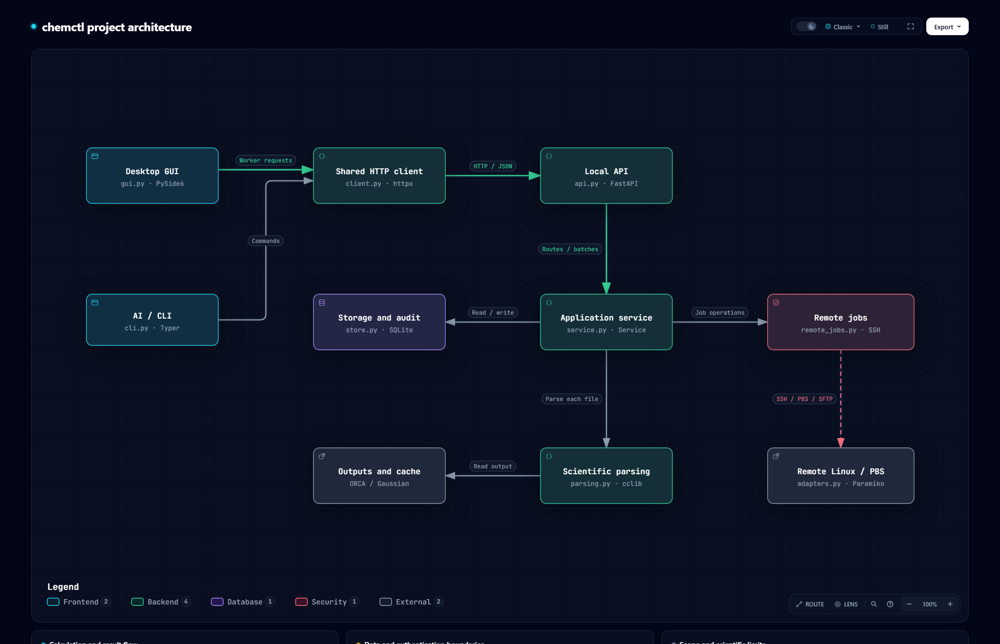

# chemctl

**English** | [简体中文](README.zh-CN.md)

A local computational chemistry workbench for parsing ORCA/Gaussian outputs and submitting, monitoring, and synchronizing PBS/Torque jobs over SSH.

## Architecture



[Download interactive diagram (English)](https://github.com/Lightmessager/chemctl/releases/download/v0.1.0/chemctl-architecture.en.html) · [中文交互图](https://github.com/Lightmessager/chemctl/releases/download/v0.1.0/chemctl-architecture.zh-CN.html)

The diagrams preserve the original project map layout and reflect the current implementation. Download the standalone HTML and open it in a browser for source links, themes, and export controls.

## Features

- PySide6 desktop UI, JSON CLI, local FastAPI service, and SQLite index.
- Methods/functionals, basis sets, solvents, energies, geometries, frequencies, and thermochemistry.
- Gaussian Gen/GenECP mixed basis groups, such as `Pt: SDD; C/H/O: 6-31G(d)`, with ECP core-electron counts shown separately.
- PBS script previews, isolated job directories, submission receipts, monitoring, cancellation, SFTP synchronization, and linked parsing results.
- SSH agent / IdentityFile authentication; optional dedicated keys protected by Windows current-user DPAPI.
- A reusable AI automation skill. This is an early development release, not a complete scientific workflow platform.

## Install and run (Windows)

Requires Python 3.12 and [uv](https://docs.astral.sh/uv/).

```powershell
git clone https://github.com/Lightmessager/chemctl.git
cd chemctl
powershell -ExecutionPolicy Bypass -File .\scripts\install.ps1
.\Start-chemctl.cmd
```

The launcher stores local state in `.chemctl` and starts the API on `127.0.0.1:8765`. Closing the GUI does not stop the backend. No ORCA or Gaussian executable is bundled.

## Usage

Select an output file or folder on the Parser page, then inspect results and source evidence on Results. Configure your own SSH server on Servers. Once PBS is confirmed, submit an existing Bash/PBS script on Jobs.

```powershell
$chem = '.\.venv\Scripts\chemctl.exe'
& $chem parse batch --source .\examples --recursive
& $chem data query
& $chem server test myserver --password-prompt
& $chem server enable-key myserver
& $chem job submit --server myserver --input .\calculation --script run.pbs --dry-run
```

The `examples` directory contains synthetic output fragments, not real calculations. See the [detailed usage guide (Chinese)](docs/usage.md).

## AI automation

Read [chemctl-automation/SKILL.md](skills/chemctl-automation/SKILL.md), or copy that entire skill folder into your AI client's skills directory. It covers input preparation, safe submission recovery, monitoring, synchronization, and scientific result interpretation. Machine-specific settings and credentials are excluded.

## Scientific scope

Missing information remains unknown. Mixed bases are extracted from Gaussian `Centers:` and named basis blocks; explicit numeric shells remain custom rather than being guessed from elements. ECP data comes from parsed core-electron evidence: an SDD orbital basis alone does not prove an ECP was used. Arbitrary per-atom ORCA basis blocks, ONIOM, and stage-specific method assignments are not fully covered.

Energy extraction currently emphasizes Gaussian SCF and ORCA final electronic-energy markers. Full MP2/CC energy semantics and IRC/transition-state validation are not implemented. Normal termination is not equivalent to scientific convergence. cclib coverage varies by engine version and output format.

## Development

```powershell
.\.venv\Scripts\python.exe -m pytest -q
```

Source is in `src/chemctl`. The repository includes code, the app icon, scripts, synthetic fixtures, focused tests, documentation, and the reusable skill. Runtime databases, SSH keys, real calculation files, and personal settings are excluded.

## License

Project code is available under the [MIT License](LICENSE). Dependencies retain their own licenses; see [THIRD_PARTY_NOTICES.md](THIRD_PARTY_NOTICES.md).
