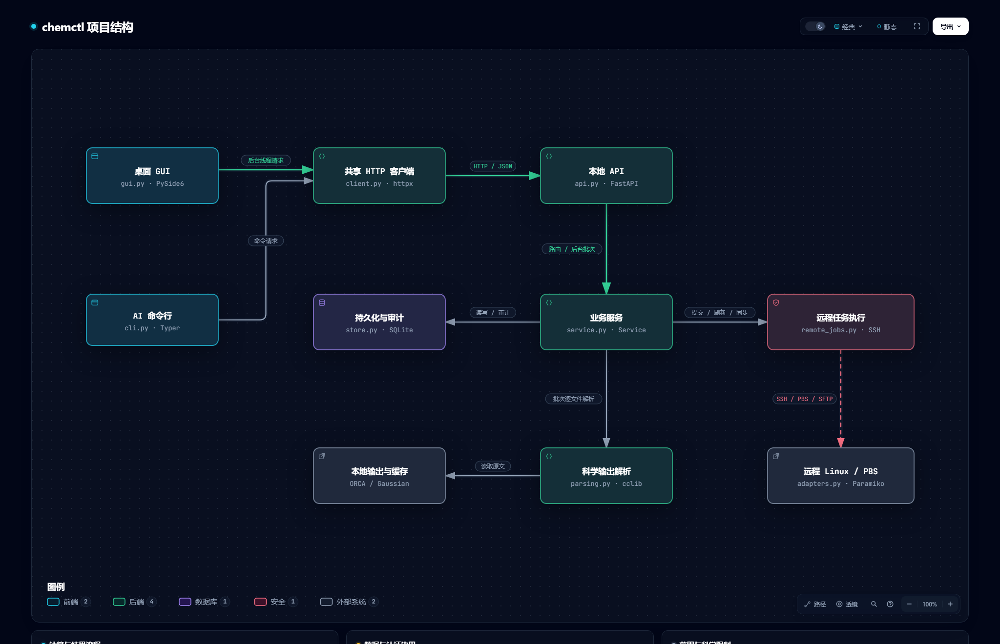

# chemctl

[English](README.md) | **简体中文**

本地计算化学工作台：解析 ORCA / Gaussian 输出，通过 SSH 向 PBS/Torque 提交任务、监控状态、同步结果。

## 项目结构



[下载交互结构图（中文）](https://github.com/Lightmessager/chemctl/releases/download/v0.1.0/chemctl-architecture.zh-CN.html) · [English diagram](https://github.com/Lightmessager/chemctl/releases/download/v0.1.0/chemctl-architecture.en.html)

## 功能

- PySide6 桌面界面、JSON CLI、FastAPI 本地服务与 SQLite 索引。
- 方法/泛函、基组、溶剂、能量、结构、频率与热化学数据提取。
- Gaussian Gen/GenECP 混合基组按原子和元素展示，例如 `Pt: SDD; C/H/O: 6-31G(d)`；ECP 核心电子数单独展示。
- PBS 脚本预览、独立任务目录、提交回执、监控、取消、SFTP 同步及结果关联。
- SSH agent / IdentityFile 登录；Windows 可生成专用密钥，用当前用户 DPAPI 加密保存私钥。
- 图标与深色桌面界面。开发版本，尚非完整科学工作流平台。

## 安装与启动（Windows）

需要 Python 3.12 与 [uv](https://docs.astral.sh/uv/)。

```powershell
git clone https://github.com/Lightmessager/chemctl.git
cd chemctl
powershell -ExecutionPolicy Bypass -File .\scripts\install.ps1
.\Start-chemctl.cmd
```

启动器使用项目 `.chemctl` 保存本机数据，API 默认仅监听 `127.0.0.1:8765`。关闭窗口不会停止后台服务。

## 使用

在 Parser 页选择输出文件或目录，解析后在 Results 查看结果和原文来源。Servers 页配置自己的 SSH 服务器，检查连接；确认 PBS 后可在 Jobs 提交现有 Bash/PBS 脚本。

```powershell
$chem = '.\.venv\Scripts\chemctl.exe'
& $chem parse batch --source .\examples --recursive
& $chem data query
& $chem server test myserver --password-prompt
& $chem server enable-key myserver
& $chem job submit --server myserver --input .\calculation --script run.pbs --dry-run
```

详见 [使用说明](docs/usage.md)。`examples` 为合成格式片段，不是真实计算数据。

## 解析边界

输出缺少的信息保留为空。混合基组从 Gaussian 打印的 `Centers:` 和命名基组块提取；仅有数值壳层时标记自定义，不能凭元素猜测 SDD。ECP 来自解析到的核心电子信息，不把 SDD 轨道基组自动等同于已使用 ECP。支持常见命名基组，尚未完整覆盖任意逐原子 ORCA 基组块、ONIOM 和多阶段方法分配。

当前能量提取以 Gaussian SCF 与 ORCA 最终电子能量标记为主，未完整实现 MP2/CC 最终能量、IRC/TS 判定等语义。正常终止不等于过渡态验证或所有收敛条件成立。基于 cclib 的字段覆盖随程序版本和输出格式变化。

## 开发

```powershell
.\.venv\Scripts\python.exe -m pytest -q
```

源码在 `src/chemctl`；只提交源码、图标、安装脚本、合成样例和小型回归测试。运行数据库、SSH 密钥、真实计算输入输出和个人配置不属于发布内容。

## 许可

项目代码使用 [MIT License](LICENSE)。第三方依赖保留各自许可，见 [THIRD_PARTY_NOTICES.md](THIRD_PARTY_NOTICES.md)。

## AI 自动化技能

可读取 [chemctl-automation 技能](skills/chemctl-automation/SKILL.md)，或将整个目录复制到 AI 客户端的技能目录。本机配置与密钥不包含在分发文件中。
